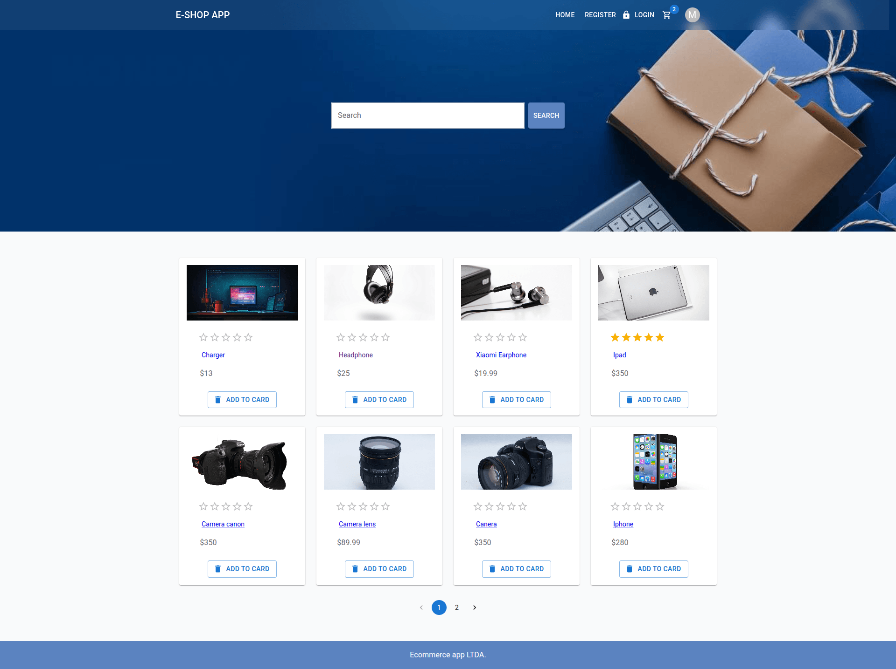
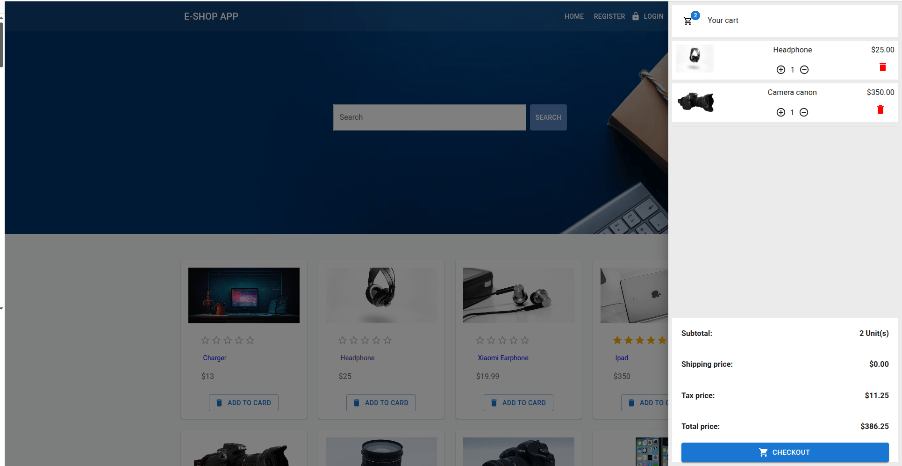
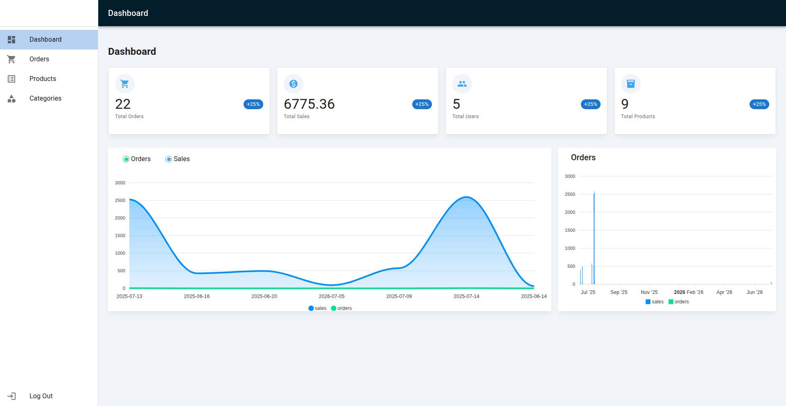
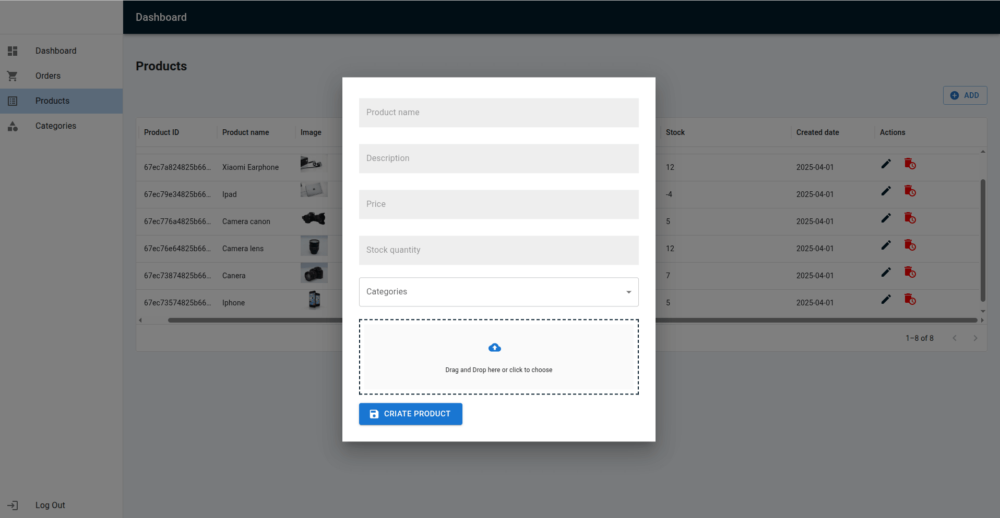

# eshopappltd

## Overview

`eshopappltd` is a modern ecommerce platform built with a clean separation between frontend and backend.

- Frontend: React with Material UI, Redux Toolkit, Formik/Yup validation, and MUI DataGrid.
- Backend: Node.js with TypeScript, Express, MongoDB, following repository/controller design patterns, cookie-based authentication, and Stripe integration.









## Features

### Frontend

- Material UI component library and responsive design
- Redux Toolkit for global state management
- Formik + Yup for robust form handling and validation
- MUI DataGrid for admin tables and lists
- User dashboard and admin dashboard
- Product browsing, search, cart, checkout flow
- Login/Register and protected routes for users and admins
- Notifications with toast messages

### Backend

- Node.js + TypeScript API server
- Express framework with middleware-based architecture
- MongoDB as the database
- Authentication with JWT and cookies
- Role-based access control for admin and user routes
- Error handling middleware and validation middleware
- Stripe payment integration for checkout
- Cloudinary support for image handling
- Organized controllers, repositories, models, routes, and utilities

## Repository Structure

```
/README.md
/backend
  /src
    /controllers
    /erros
    /middleware
    /models
    /repo
      /baseRepository
    /routes
    /types
    /utils
/frontend
  /public
  /src
    /admin
    /components
    /front
    /hooks
    /redux
      /constants
      /slices
    /user
    /utils
```

## Backend Setup

### Requirements

- Node.js 22.x
- MongoDB

### Installation

1. Open a terminal in the project root.
2. Install root dependencies for backend tooling and TypeScript:

```bash
npm install
```

3. Install frontend dependencies separately:

```bash
cd frontend
npm install
```

### Environment Variables

Create a `.env` file in the root or `backend/` folder with values similar to:

```env
PORT=8000
MONGO_URI=<your-mongodb-connection-string>
JWT_SECRET=<your-jwt-secret>
COOKIE_NAME=<cookie-name>
CLOUDINARY_CLOUD_NAME=<cloud-name>
CLOUDINARY_API_KEY=<cloudinary-api-key>
CLOUDINARY_API_SECRET=<cloudinary-api-secret>
STRIPE_SECRET_KEY=<stripe-secret-key>
```

### Run the Backend

From the project root:

```bash
npm run start
```

This launches the backend with `ts-node-dev` and watches TypeScript changes.

### Build for Production

```bash
npm run build
npm run deploy
```

## Frontend Setup

### Requirements

- Node.js 22.x

### Install Dependencies

From the root:

```bash
cd frontend
npm install
```

### Run the Frontend

From `frontend/`:

```bash
npm start
```

The frontend proxies API requests to `http://localhost:8000` by default.

### Build for Production

```bash
npm run build
```

## API and Frontend Integration

- The frontend uses `axios` to call backend APIs.
- Protected routes rely on cookies and JWT tokens stored by the backend.
- Checkout uses Stripe via the backend Stripe controller.
- Admin features are gated by user role checks on both client and server.

## Backend Architecture

### Controllers

- `productController.ts`
- `categoryController.ts`
- `orderController.ts`
- `stripeController.ts`
- `userController.ts`

Controllers handle request logic and delegate database operations to repositories.

### Repositories

- `productRepo.ts`
- `categoryRepo.ts`
- `orderRepo.ts`
- `userRepo.ts`

Repositories encapsulate MongoDB model operations and centralize data access.

### Middleware

- `auth.ts` — protects routes and checks user roles
- `errorHandler.ts` — central error handling middleware
- `validateRequest.ts` — request validation and schema enforcement

### Models

- Product, Category, Order, User
- Built with Mongoose and TypeScript interfaces for strong typing

## Frontend Architecture

### Pages and Layouts

- `Home.js` — product listing and search experience
- `ViewProduct.js` — product detail view
- `Checkout.js` — payment and order confirmation flow
- `Login.js` / `Register.js` — auth forms
- Admin pages for product, category, and order management
- User dashboard pages for purchase history and profile

### State Management

- `redux/store.js` configures the Redux store
- `redux/slices/` contains feature slices controlling app state
- Frontend uses `react-redux` hooks to connect UI with state

### Forms and Validation

- `Formik` handles form state and submission
- `Yup` defines validation schemas for login, registration, product management, and checkout forms

### UI Components

- Material UI components for app layout, navigation, buttons, forms, and cards
- `@mui/x-data-grid` for admin tables and product/order listings
- Custom reusable components like `Header`, `Footer`, `Loader`, and `Modal`

## Deployment Notes

- Build the frontend with `npm run build` inside `frontend/`.
- Build backend TypeScript and deploy `backend/dist`.
- Ensure environment variables are configured in production.
- If hosting with a single deployment, serve the built frontend from a static host and connect it to the backend API.

## Notes

- The `old/` folder contains legacy code and is not part of the current active application.
- Use the current `backend/` and `frontend/` directories for development and deployment.

## Contact

Author: Emmanuel F.

---

This documentation reflects the current app setup and technology stack for `eshopappltd` new version.
